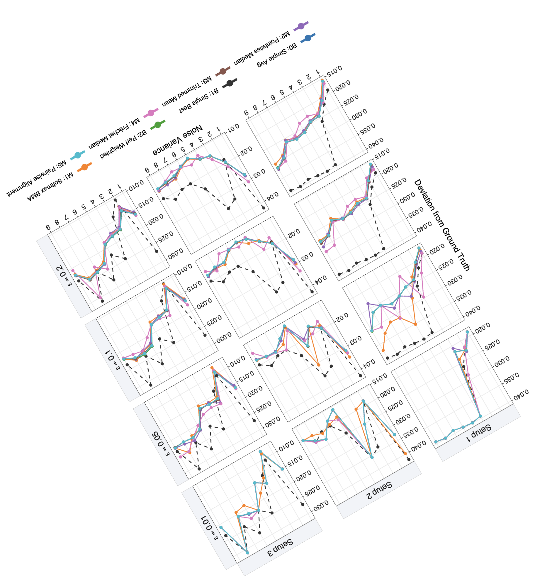
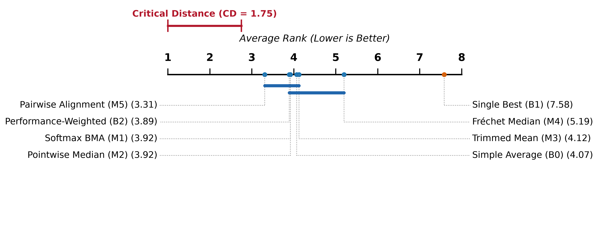

# Aggregating Rashomon Partial Dependence Profiles: A Systematic Empirical Evaluation

[](https://ida2027.eu/)
[](#reproducibility-guide)
[](LICENSE)

This repository provides the complete reproducibility artifact, raw experimental data, scripts, and evaluation pipelines for the paper:  
**"Aggregating Rashomon Partial Dependence Profiles: A Systematic Empirical Evaluation"** (Submitted to IDA 2027).

---

## Executive Summary of Findings

In high-stakes decision-making and automated machine learning (AutoML), practitioners conventionally select a single top-performing model and generate explainability profiles (e.g., Partial Dependence Plots) solely from this empirical risk minimizer. However, when multiple competing models achieve near-optimal predictive loss—the **Rashomon effect**—relying on a single model introduces acute **explanation disagreement** and uncertainty.

### Key Empirical Takeaways:
1. **Pervasiveness of Multiplicity & Ambiguity:**  
   Across 27 synthetic benchmark conditions and real-world datasets (e.g., UCI Adult Income, Credit Approval), expanding the Rashomon tolerance $\varepsilon$ from $0.01$ to $0.20$ reveals substantial empirical profile ambiguity ($\bar{A} \ge 0.15$), where models with virtually identical log-loss produce starkly diverging feature attribution curves.
2. **Superiority of Aggregated Profiles:**  
   Pointwise profile aggregation across the Rashomon set consistently outperforms the single best model baseline ($\mathrm{B1}$). A nonparametric Friedman test followed by post-hoc Nemenyi critical distance analysis ($\alpha = 0.05, \mathrm{CD} = 1.75$) demonstrates that multi-model profile aggregation significantly reduces Mean Deviation from Ground Truth ($\mathrm{MD}(\mathrm{GT})$).
3. **Robustness Over Pure Arithmetic Averaging:**  
   While uniform arithmetic averaging ($\mathrm{B0}$) provides an initial reduction in estimation noise, robust order statistics—particularly **Pointwise Median ($\mathrm{M2}$)** and **Functional Geometric Median ($\mathrm{M4}$)**—demonstrate superior resistance against atypical model trajectories and skewed hypothesis subsets.
4. **Empirical Ambiguity as a Practical Safeguard:**  
   Our proposed empirical profile ambiguity metric $\mathcal{A}_{\varepsilon}(x_j)$ serves as a practical diagnostic tool: when ambiguity is negligible, single-model explanations suffice; when ambiguity is elevated, profile aggregation is necessary to prevent arbitrariness in algorithmic explanations.

---

## Key Figures and Results

### Figure 1: Multi-Panel Mean Deviation from Ground Truth across Rashomon Thresholds
Comparison of Mean Deviation from Ground Truth ($\mathrm{MD}(\mathrm{GT})$) across all four Rashomon thresholds ($\varepsilon \in \{0.01, 0.05, 0.10, 0.20\}$) across all 27 synthetic benchmark scenarios ($3\text{ setups} \times 9\text{ noise variance levels}$, $n=1{,}500$, 160 base models, 2880s compute budget per scenario). The solid grey line indicates the conventional single best model baseline (B1).

<p align="center">
  
</p>

---

### Figure 2: Critical Distance Diagram for Post-Hoc Nemenyi Test
Post-hoc Nemenyi test on Mean Deviation from Ground Truth across all 36 benchmark conditions ($\alpha=0.05, \mathrm{CD}=1.75$). Lower average rank indicates closer alignment with ground truth. Thick horizontal bars connect methods whose performance differences do not exceed the critical distance threshold. All aggregation strategies significantly outperform the single best model baseline (B1, average rank 7.58).

<p align="center">
  
</p>

---

### Table 2: Mean Deviation from Ground Truth ($\mathrm{MD}(\mathrm{GT})$) across Rashomon Thresholds
Mean Deviation from Ground Truth across Rashomon thresholds $\varepsilon \in \{0.01, 0.05, 0.10, 0.20\}$ grouped into noise variance regimes: low ($\sigma^2 \in \{1,2,3\}$), mid ($\sigma^2 \in \{4,5,6\}$), and high ($\sigma^2 \in \{7,8,9\}$). Values report the mean across the three noise levels per regime ($n=1{,}500$, 160 models, 2880s budget per run). Shaded columns report scenario metadata: average candidate count $\bar{K}$, Rashomon ratio $\bar{\rho}$, empirical ambiguity $\bar{A}$, and diversity coefficient $\bar{\kappa}$. Bold denotes the lowest mean MD within each row.

| Setup | Noise | $\varepsilon$ | $\bar{K}$ | $\bar{\rho}$ | $\bar{A}$ | $\bar{\kappa}$ | B1 | B0 | B2 | M1 | M2 | M3 | M4 | M5 |
| :---: | :---: | :---: | :---: | :---: | :---: | :---: | :---: | :---: | :---: | :---: | :---: | :---: | :---: | :---: |
| **(1)** | low | 0.01 | 2 | 0.01 | 0.008 | 0.18 | 0.022 | 0.021 | 0.021 | 0.022 | **0.021** | 0.021 | 0.023 | 0.021 |
| | | 0.05 | 18 | 0.09 | 0.014 | 0.29 | 0.022 | 0.020 | 0.020 | **0.020** | 0.021 | 0.021 | 0.024 | 0.020 |
| | | 0.10 | 54 | 0.28 | 0.020 | 0.36 | 0.022 | 0.020 | 0.020 | **0.020** | 0.020 | 0.020 | 0.020 | 0.020 |
| | | 0.20 | 128 | 0.65 | 0.046 | 0.56 | 0.022 | 0.020 | 0.020 | **0.020** | 0.020 | 0.020 | 0.020 | 0.020 |
| | mid | 0.01 | 1 | 0.01 | 0.010 | 0.12 | **0.040** | 0.040 | 0.040 | 0.040 | 0.040 | 0.040 | 0.040 | 0.040 |
| | | 0.05 | 4 | 0.02 | 0.019 | 0.25 | 0.040 | **0.026** | 0.026 | 0.032 | 0.027 | 0.026 | 0.026 | 0.026 |
| | | 0.10 | 60 | 0.31 | 0.067 | 0.55 | 0.040 | 0.025 | 0.025 | 0.025 | 0.025 | 0.025 | **0.024** | 0.025 |
| | | 0.20 | 163 | 0.87 | 0.084 | 0.59 | 0.040 | 0.026 | 0.026 | 0.026 | 0.026 | 0.026 | **0.024** | 0.026 |
| | high | 0.01 | 1 | 0.01 | 0.012 | 0.11 | **0.039** | 0.039 | 0.039 | 0.039 | 0.039 | 0.039 | 0.039 | 0.039 |
| | | 0.05 | 3 | 0.02 | 0.068 | 0.51 | 0.039 | 0.028 | 0.028 | 0.034 | **0.027** | 0.028 | 0.029 | 0.028 |
| | | 0.10 | 44 | 0.34 | 0.084 | 0.55 | 0.039 | 0.027 | 0.027 | **0.026** | 0.027 | 0.027 | 0.029 | 0.027 |
| | | 0.20 | 112 | 0.88 | 0.111 | 0.58 | 0.039 | 0.029 | 0.029 | **0.028** | 0.029 | 0.029 | 0.030 | 0.029 |
| **(2)** | low | 0.01 | 2 | 0.02 | 0.004 | 0.18 | 0.031 | **0.025** | 0.025 | 0.026 | 0.025 | 0.025 | 0.025 | 0.025 |
| | | 0.05 | 11 | 0.14 | 0.007 | 0.38 | 0.031 | 0.022 | 0.022 | 0.023 | 0.023 | 0.022 | 0.023 | **0.022** |
| | | 0.10 | 37 | 0.41 | 0.008 | 0.42 | 0.031 | 0.021 | 0.021 | 0.022 | 0.022 | 0.021 | 0.023 | **0.021** |
| | | 0.20 | 75 | 0.82 | 0.010 | 0.44 | 0.031 | 0.021 | 0.021 | 0.021 | 0.021 | 0.021 | 0.023 | **0.021** |
| | mid | 0.01 | 2 | 0.03 | 0.004 | 0.18 | 0.027 | 0.023 | 0.023 | 0.025 | 0.023 | 0.023 | 0.025 | **0.023** |
| | | 0.05 | 17 | 0.18 | 0.008 | 0.35 | 0.027 | 0.017 | 0.017 | 0.020 | **0.016** | 0.017 | 0.018 | 0.017 |
| | | 0.10 | 42 | 0.59 | 0.012 | 0.41 | 0.027 | 0.013 | 0.013 | 0.013 | **0.012** | 0.013 | 0.013 | 0.013 |
| | | 0.20 | 62 | 0.91 | 0.016 | 0.44 | 0.027 | 0.013 | 0.013 | 0.013 | **0.012** | 0.013 | 0.013 | 0.012 |
| | high | 0.01 | 2 | 0.02 | 0.004 | 0.17 | 0.021 | 0.022 | 0.022 | **0.020** | 0.022 | 0.022 | 0.022 | 0.022 |
| | | 0.05 | 32 | 0.23 | 0.011 | 0.34 | 0.021 | 0.018 | 0.018 | 0.018 | 0.018 | 0.018 | **0.018** | 0.018 |
| | | 0.10 | 102 | 0.70 | 0.018 | 0.42 | 0.021 | 0.017 | 0.017 | 0.017 | 0.017 | 0.017 | **0.015** | 0.017 |
| | | 0.20 | 136 | 0.94 | 0.022 | 0.44 | 0.021 | 0.015 | 0.015 | 0.016 | 0.016 | 0.015 | **0.014** | 0.015 |
| **(3)** | low | 0.01 | 2 | 0.01 | 0.004 | 0.11 | 0.017 | 0.013 | 0.013 | **0.013** | 0.013 | 0.013 | 0.013 | 0.013 |
| | | 0.05 | 16 | 0.10 | 0.011 | 0.28 | 0.017 | 0.014 | 0.014 | **0.013** | 0.014 | 0.014 | 0.014 | 0.014 |
| | | 0.10 | 65 | 0.41 | 0.018 | 0.40 | 0.017 | 0.015 | 0.015 | **0.015** | 0.015 | 0.015 | 0.016 | 0.015 |
| | | 0.20 | 126 | 0.79 | 0.023 | 0.46 | 0.017 | 0.016 | 0.016 | 0.015 | **0.015** | 0.016 | 0.015 | 0.016 |
| | mid | 0.01 | 2 | 0.02 | 0.006 | 0.12 | 0.025 | 0.019 | 0.019 | 0.020 | 0.019 | 0.019 | 0.020 | **0.019** |
| | | 0.05 | 30 | 0.29 | 0.021 | 0.34 | 0.025 | 0.018 | 0.018 | **0.018** | 0.018 | 0.018 | 0.019 | 0.018 |
| | | 0.10 | 72 | 0.65 | 0.034 | 0.46 | 0.025 | 0.019 | 0.019 | 0.019 | 0.019 | 0.019 | **0.019** | 0.019 |
| | | 0.20 | 107 | 0.94 | 0.038 | 0.50 | 0.025 | 0.020 | 0.020 | **0.019** | 0.020 | 0.020 | 0.020 | 0.020 |
| | high | 0.01 | 1 | 0.02 | 0.009 | 0.15 | 0.026 | 0.024 | 0.024 | **0.024** | 0.024 | 0.024 | 0.024 | 0.024 |
| | | 0.05 | 18 | 0.18 | 0.034 | 0.41 | 0.026 | 0.022 | 0.022 | 0.023 | 0.023 | **0.022** | 0.024 | 0.022 |
| | | 0.10 | 68 | 0.59 | 0.039 | 0.45 | 0.026 | 0.023 | 0.023 | 0.023 | 0.023 | 0.023 | **0.022** | 0.023 |
| | | 0.20 | 100 | 0.91 | 0.045 | 0.48 | 0.026 | 0.024 | 0.024 | **0.023** | 0.024 | 0.024 | 0.024 | 0.024 |

---

## Repository Structure

```
├── scripts/                        # Source code and execution scripts
│   ├── run_classification_experiments.py     # Main AutoML pipeline & PDP generator
│   ├── analyze_classification_results.py     # Metrics computation (MD, Ambiguity, CI)
│   ├── generate_nemenyi_cd_diagram.py        # Post-hoc Nemenyi critical distance plot
│   ├── generate_ggplot2_figure_classification.R # Main benchmark MD comparison plots (Fig 1)
│   ├── generate_nemenyi_cd_diagram.py        # Post-hoc Nemenyi critical distance plot (Fig 2)
│   ├── generate_figure_real_world_ambiguity.R # Real-world profile ambiguity comparison (Fig 3)
│   ├── run_classification_experiments.py     # Main AutoML pipeline & PDP generator
│   ├── run_screening_10datasets.py           # Real-world benchmark screening pipeline
│   ├── run_real_world_5datasets.py           # Real-world benchmark evaluation pipeline
│   └── generate_latex_table_15datasets.py    # Generates Table 3
├── results/                        # Raw experimental outputs and serialized profiles
│   ├── cls_pdps/                   # Serialized PDPs for 27 benchmark scenarios (.pkl)
│   ├── master_analysis_results_classification_27scenarios.json # Full benchmark metrics
│   ├── real_world/                 # Case study PDPs and summary metrics
│   └── *.tex                       # Generated LaTeX table rows
├── figures/                        # Generated vector figures (PDF) and previews (PNG)
│   ├── combined_md_all_epsilons.pdf          # Fig 1: MD across Rashomon thresholds (PDF)
│   ├── combined_md_all_epsilons.png          # Fig 1: MD across Rashomon thresholds (PNG)
│   ├── nemenyi_cd_diagram.pdf                # Fig 2: Critical distance diagram (PDF)
│   ├── nemenyi_cd_diagram.png                # Fig 2: Critical distance diagram (PNG)
│   ├── real_world_ambiguity_figure.pdf       # Fig 3: Real-world ambiguity audit (PDF)
│   └── real_world_ambiguity_figure.png       # Fig 3: Real-world ambiguity audit (PNG)
├── requirements.txt                # Python dependencies
└── README.md                       # Documentation and reproduction guide
```

---

## Reproducibility Guide

### 1. Environment Setup

The pipeline requires **Python 3.9+** and optionally **R 4.2+** (for ggplot2 rendering).

```bash
# Clone the repository
git clone https://github.com/mcavs/IDA-2027.git
cd IDA-2027

# Create and activate a virtual environment
python3 -m venv venv
source venv/bin/activate

# Install required Python packages
pip install --upgrade pip
pip install -r requirements.txt
```

*Note for R users:* To regenerate R plots, install `ggplot2`, `patchwork`, `dplyr`, and `DALEX` in R:
```R
install.packages(c("ggplot2", "patchwork", "dplyr", "DALEX"))
```

---

### 2. Quick Reproduction (Precomputed Data)

To reproduce the tables, critical distance diagrams, and figures directly from the serialized PDP artifacts without rerunning hundreds of hours of AutoML search:

#### Generate Post-Hoc Nemenyi Critical Distance Diagram:
```bash
python scripts/generate_nemenyi_cd_diagram.py
# Outputs: figures/nemenyi_cd_diagram.pdf and figures/nemenyi_cd_diagram.png
```

#### Recompute Aggregation Metrics & LaTeX Tables:
```bash
python scripts/analyze_classification_results.py
python scripts/generate_latex_tables_classification.py
```

#### Render Multi-Panel PDP and Ground Truth Comparison Plots (R - Figure 1):
```bash
Rscript scripts/generate_ggplot2_figure_classification.R
# Outputs: figures/combined_md_all_epsilons.pdf
```

#### Render Real-World Ambiguity Comparison (R - Figure 3):
```bash
Rscript scripts/generate_figure_real_world_ambiguity.R
# Outputs: figures/real_world_ambiguity_figure.pdf and figures/real_world_ambiguity_figure.png
```

---

### 3. Full Benchmark Execution (From Scratch)

To train new H2O AutoML models across all 27 data-generating configurations ($n=1{,}500$, 160 base models, 2880s per scenario budget) and generate fresh PDP curves:

```bash
# Launch H2O AutoML search and serialize PDP curves (Note: Requires multi-core CPU and significant compute time)
python scripts/run_classification_experiments.py

# Evaluate real-world datasets
python scripts/run_real_world_classification.py
```

